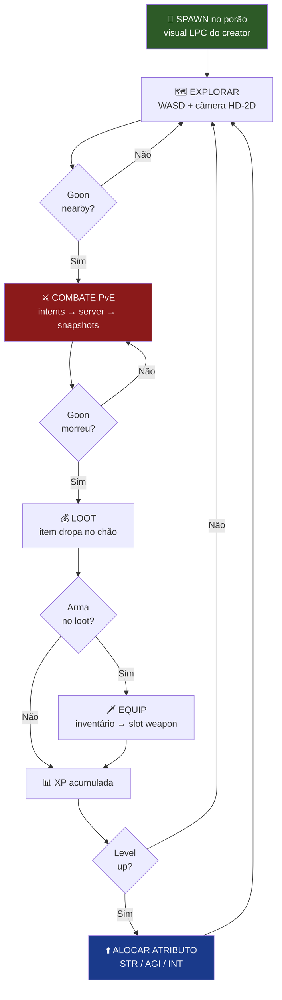
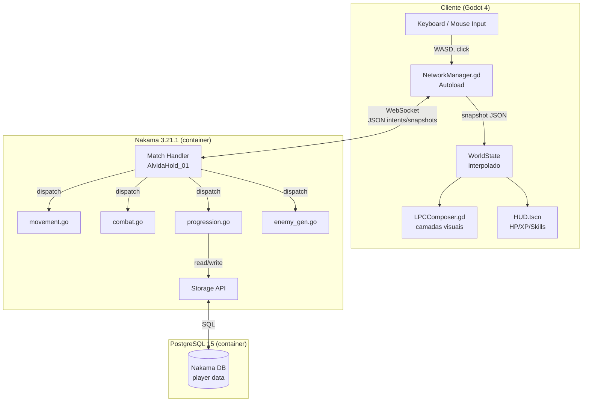
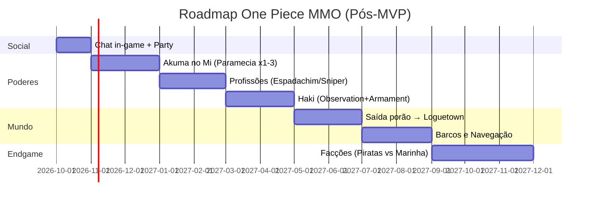

# Design Spec — MVP Alvida Hold
**Data:** 2026-09-17  
**Status:** Aprovado  
**Versão:** 1.0

---

## Seção 1 — Norte vs Corte Vertical e Loop de Jogo

### 1.1 Norte (Visão Completa)

O "norte" é o MMO sandbox completo descrito no documento fundador: mundo aberto com ilhas, tripulações de jogadores, Akuma no Mi, Haki, profissões, facções (piratas vs Marinha) e guerra de territórios. Esta visão **não** é o que construímos agora — ela orienta as decisões de arquitetura para que o MVP seja expansível.

### 1.2 Corte Vertical — Build 1: Porão da Alvida

**Premissa:** Dois jogadores cooperativos presos no porão do navio da Alvida. Sobreviver = progressão. Sem saída desta build.

**O que implementamos:**

| Feature | Incluída | Notas |
|---|---|---|
| Compositor de personagem LPC | ✅ | Corpo, cabelo, roupa, cor |
| Combate PvE autoritativo | ✅ | Servidor valida 100% |
| Inimigos LPC auto-gerados | ✅ | Seed + catálogo, 1–2 archetypes |
| Loot + equip de arma | ✅ | Arma → skill desbloqueada |
| Progressão XP/level/stats | ✅ | STR, AGI, INT |
| Persistência Storage | ✅ | Relogin mantém tudo |
| Chat in-game | ❌ | Pós-MVP |
| PvP / friendly fire | ❌ | Jamais nesta build |
| Facções | ❌ | Por último no roadmap |
| Akuma no Mi | ❌ | Fase 2 do roadmap |
| Haki | ❌ | Fase 4 do roadmap |
| Profissões | ❌ | Fase 3 do roadmap |
| Mundo aberto | ❌ | Fase 5 do roadmap |

### 1.3 Loop de Jogo da Build 1



**Goons respawnam após 30 segundos.** O loop é infinito (endurance coop).

### 1.4 Pilares de Design da Build 1

1. **Coop genuíno:** Os dois jogadores se veem, coordenam ataques e compartilham o espaço em tempo real.
2. **Progressão visível:** Cada level e cada arma nova muda o que o jogador pode fazer (nova skill no HUD).
3. **Servidor autoritativo:** Zero clientside prediction de dano — feedback imediato vem do snapshot, não de hack local.
4. **Visual único por inimigo:** Mesmo archetype, aparência diferente — gerada por seed, sem arte manual extra.

---

## Seção 2 — Arquitetura

### 2.1 Diagrama de Arquitetura



### 2.2 Tabela de Módulos Go

| Módulo | Arquivo | Função Principal | Inputs | Outputs |
|---|---|---|---|---|
| Handler | `match/handler.go` | Tick loop 20 Hz, dispatcher | Mensagens WebSocket | Snapshot broadcast |
| Movement | `match/movement.go` | Validação de posição | Intent `move` {dx, dy} | Posição atualizada no estado |
| Combat | `match/combat.go` | Dano, HP, cooldown, range | Intent `attack` {target_id} | Eventos damage/death |
| Progression | `match/progression.go` | XP, level, atributos, Storage | Intent `allocate_stat`, eventos de death | Profile atualizado |
| Enemy Gen | `match/enemy_gen.go` | Spawn, AI FSM, respawn | Estado do match, tick | Inimigos no snapshot |

### 2.3 Contrato de Rede

**Intent (Cliente → Servidor) — envelope:**
```json
{
  "type": "<string>",
  "data": { "<campos específicos do tipo>" }
}
```

**Tipos de Intent:**

| Tipo | Campos em `data` | Validação no Servidor |
|---|---|---|
| `move` | `dx: float, dy: float` | Magnitude ≤ 1.0; sem teleporte |
| `attack` | `target_id: string` | Range ≤ 1.5u; cooldown ≥ 0.5s |
| `collect_loot` | `loot_id: string` | Item existe no mapa; jogador em range |
| `equip` | `item_id: string, slot: string` | Item no inventário; slot válido |
| `allocate_stat` | `stat: string` | stat ∈ {str, agi, int}; stat_points > 0 |

**Snapshot (Servidor → Todos) — estrutura completa:**
```json
{
  "tick": 1423,
  "players": [
    {
      "id": "player_uuid",
      "x": 3.5, "y": 0.0, "z": 2.1,
      "hp": 85, "max_hp": 100,
      "state": "walk",
      "dir": "right",
      "xp": 340, "level": 2,
      "equipped_weapon": "sword_01"
    }
  ],
  "enemies": [
    {
      "id": "e_0_1",
      "archetype": "goon_a",
      "x": 5.0, "y": 0.0, "z": 2.1,
      "hp": 40, "max_hp": 60,
      "state": "chase",
      "dir": "left",
      "appearance_seed": 12345
    }
  ],
  "loot_items": [
    { "id": "loot_0", "item_id": "sword_01", "x": 5.0, "z": 2.1 }
  ],
  "events": [
    { "type": "damage", "target": "e_0_1", "amount": 15, "attacker": "player_uuid" },
    { "type": "enemy_death", "enemy_id": "e_0_1", "respawn_in": 30 },
    { "type": "loot_drop", "loot_id": "loot_0", "item_id": "sword_01" },
    { "type": "level_up", "player_id": "player_uuid", "new_level": 3 }
  ]
}
```

### 2.4 Fluxo de Boot da Infraestrutura

```
docker compose up --build
      │
      ├─► [backend-builder] go build -buildmode=plugin → /build/plugin.so
      │
      ├─► [postgres] init DB nakama, aguarda conexão
      │
      └─► [nakama] aguarda postgres saudável
              │
              ├─ carrega /nakama/data/modules/plugin.so
              ├─ InitModule() registra AlvidaHold_01 factory
              ├─ Expõe :7350 (API/WS) e :7351 (console)
              └─ Pronto para conexão de clientes Godot
```

---

## Seção 3 — LPC/Personagem, Inimigos, Combate e Progressão

### 3.1 Sistema LPC de Personagem

**Camadas (ordem de renderização, de baixo para cima):**

```
Layer 4: Weapon      (sword, staff, etc.)
Layer 3: Outfit      (pirate_a, guard_b, etc.)
Layer 2: Hair        (long_black, short_brown, etc.)
Layer 1: Body        (male_light, male_dark, female_light, etc.)
```

**`LPCComposer.gd`** carrega 4 `Sprite3D` filhos com textura e frame sincronizados pelo estado da animação:
- Estado: `idle` | `walk` | `attack`
- Direção: `up` | `down` | `left` | `right`
- Frame calculado: `row * 8 + frame_index`

**Creator de Personagem:**
- Painel UI ao entrar pela primeira vez (ou sem perfil Storage)
- Escolha: body type, hair style, outfit, cor de cabelo
- Ao confirmar: salva `appearance` no Storage Nakama
- No join do match: servidor lê `appearance` e inclui no snapshot de join

### 3.2 Inimigos Auto-gerados por Seed

**Algoritmo de geração:**

```
seed = fnv1a_hash(match_id + "_" + spawn_slot_index)
rng = NewRand(seed)

body   = lpc_catalog.bodies[rng.Intn(len(bodies))]
hair   = lpc_catalog.hairs[rng.Intn(len(hairs))]
outfit = lpc_catalog.outfits[rng.Intn(len(outfits))]
```

**Propriedades:**
- Aparência visual: determinística pelo seed (mesma seed = mesmo visual em todos os clientes)
- Archetype (behavior + stats): definido pelo `spawn_point` configuration, independente da aparência
- Dois archetypes para MVP:
  - `goon_a`: 60 HP, dano 8, velocidade 1.8u/s, range 1.5u (melee lento)
  - `goon_b`: 40 HP, dano 12, velocidade 2.5u/s, range 1.5u (melee rápido)

**Transmissão da aparência:** O snapshot de spawn inclui `appearance_seed`. O cliente reconstrói o visual localmente com `LPCComposer` + seed — não é necessário transmitir body/hair/outfit a cada tick.

### 3.3 Combate Autoritativo

**Mecânicas servidor-side:**

| Mecânica | Regra |
|---|---|
| Range de ataque | AABB: distância euclidiana ≤ 1.5u (melee) |
| Cooldown | 0.5s entre ataques (por player) |
| Dano base | Punch: 8 + STR/2 |
| Dano c/ espada | 12 + STR/2 |
| Sem friendly fire | Players não se causam dano |
| Morte de inimigo | HP = 0 → evento `enemy_death` + loot roll + respawn timer 30s |
| Morte de player | HP = 0 → respawn no spawn point mais próximo (3s delay), HP restaurado a 50% |

**AI dos inimigos (FSM simples):**

```
WANDER → anda para ponto aleatório próximo (vel 0.5× normal)
   │
   └─ Player em range 6u? → CHASE
         │
         └─ Player em range 1.5u? → ATTACK
               │
               └─ Player sai de range 8u? → WANDER
```

### 3.4 Sistema de Progressão (STR/AGI/INT)

**Atributos:**

| Atributo | Efeito |
|---|---|
| STR (Força) | +Dano físico, +HP máximo |
| AGI (Agilidade) | +Velocidade de movimento, -Cooldown de ataque |
| INT (Inteligência) | +Eficácia futura de Haki/curas (reservado) |

**Fórmulas:**

```
HP máximo = 100 + (STR × 5)
Dano punch = 8 + (STR / 2)
Dano arma  = weapon_base + (STR / 2)
Velocidade = 3.0 + (AGI × 0.05) u/s
Cooldown   = max(0.3, 0.5 - (AGI × 0.005)) s
```

**Progressão de XP:**

```
XP para level N = 100 × N × 1.2^(N-1)
XP por goon_a   = 25
XP por goon_b   = 40
```

Ao subir de nível: `stat_points += 2`. Player usa intent `allocate_stat` para gastar um ponto por vez.

**Skills de Arma:**

| Arma | Skill Desbloqueada | Efeito |
|---|---|---|
| (nenhuma) | Punch | Dano base, alcance 1.5u |
| Espada | Precise Cut | Dano 1.5×, cooldown 1.0s |
| Cajado | Staff Bash | Dano 1.2×, knockback 0.5u, cooldown 0.8s |

---

## Seção 4 — Definition of Done, Fora de Escopo, Riscos e Roadmap

### 4.1 Definition of Done (DoD) — Checklist

Para a build MVP ser considerada concluída, **todos** os itens abaixo devem passar:

**Infraestrutura:**
- [ ] `docker compose up --build` roda do zero sem erros (máquina limpa com Docker)
- [ ] Nakama console acessível em `http://localhost:7351`
- [ ] Nakama API acessível em `http://localhost:7350`
- [ ] Logs mostram plugin Go carregado com sucesso

**Multijogador:**
- [ ] 2 instâncias Godot conectam ao mesmo match simultaneamente
- [ ] Jogador A vê Jogador B se movendo em tempo real
- [ ] Jogador B vê Jogador A se movendo em tempo real
- [ ] Latência de movimento visualmente aceitável (< 100ms perceptível)

**Visual:**
- [ ] Personagem exibe todas as 4 camadas LPC (body, hair, outfit, weapon)
- [ ] Animação de walk em 4 direções funciona
- [ ] Animação de attack dispara ao atacar
- [ ] Inimigos têm visual LPC único (seed funcionando)

**Combate:**
- [ ] Atacar inimigo reduz HP dele (servidor autoritativo)
- [ ] HP bar do inimigo atualiza em ambos os clientes
- [ ] Inimigo morre e desaparece após HP = 0
- [ ] Inimigo respawna após ~30 segundos
- [ ] AI do inimigo: wander → chase → attack funciona

**Progressão:**
- [ ] Loot dropa no chão ao matar inimigo
- [ ] Coletar loot adiciona ao inventário
- [ ] Equipar arma atualiza visual (camada weapon LPC)
- [ ] Equipar arma habilita botão de skill no HUD
- [ ] XP acumula e level up acontece
- [ ] Alocar stat_point muda o atributo
- [ ] HUD mostra HP, XP, botões de skill

**Persistência:**
- [ ] Desconectar e reconectar mantém: XP, level, atributos, inventário, equipped, visual
- [ ] Storage Nakama gravado com collections corretas

### 4.2 Fora de Escopo desta Build

Os itens abaixo estão **explicitamente excluídos** para manter o foco:

- **PvP:** Players não causam dano entre si.
- **Facções:** Piratas, Marinha, reputação — por último no roadmap.
- **Akuma no Mi:** Qualquer fruta do diabo ou transformação.
- **Haki:** Nenhum dos três tipos.
- **Profissões:** Sem árvores de skill especializadas.
- **Chat in-game:** Sem sistema de mensagens.
- **Party formal:** Join sem formação de grupo estruturado.
- **Mapa aberto:** Apenas o porão da Alvida.
- **Barcos/navegação:** Sem sistema de embarcação.
- **NPCs com diálogo:** Sem quests ou NPCs interativos.
- **Assets proprietários:** Zero imagens da Toei/Bandai/Oda.
- **Leaderboard:** Sem ranking nesta build.

### 4.3 Riscos e Mitigações

| Risco | Probabilidade | Impacto | Mitigação |
|---|---|---|---|
| Plugin Go incompatível com versão Nakama | Média | Alto | Fixar `golang:1.22-alpine` (mesma runtime do Nakama 3.21.1); testar build no CI |
| LPC sprites com licença inconsistente | Baixa | Alto | Verificar licença de cada asset individualmente; só commitar CC-BY confirmado |
| Latência de snapshot > 100ms local | Baixa | Médio | JSON é leve; se necessário, reduzir frequência de campos opcionais |
| Godot Nakama SDK incompatível com Godot 4.x | Média | Alto | Usar branch `godot-4` do repositório oficial; testar no Windows primeiro |
| Sprite3D z-fighting com múltiplas camadas | Média | Baixo | Usar `render_priority` diferentes por camada (0, 1, 2, 3) |
| Estado de match vazando entre sessões | Baixa | Alto | MatchLeave limpa estado em memória; Storage persiste separadamente |
| Seed de inimigo colide (dois inimigos iguais) | Baixa | Baixo | Seed inclui spawn_slot_index — naturalmente diferente por posição |
| Docker Compose porta 7350 ocupada | Baixa | Baixo | Documentar no README; adicionar instrumento para mudar porta |

### 4.4 Roadmap Revisado Pós-MVP

> **Princípio:** construir de dentro para fora. O porão → Loguetown → Sete Mares. Facções por último — dependem de mundo aberto estável e PvP balanceado.



**Justificativa da ordem:**
1. **Chat/Party primeiro:** Qualquer feature social depende de comunicação. Base para tudo.
2. **Akuma antes de Profissões:** Frutas são raras e definem "moments" — melhor com jogadores já engajados.
3. **Profissões antes de Haki:** Haki é maestria de uma profissão — precisa de identidade de combate primeiro.
4. **Loguetown antes de Facções:** Facções precisam de território. Território precisa de mundo aberto.
5. **Facções por último:** Requerem PvP balanceado, sistema de reputação, siege — complexidade máxima. Apressar facções sem estas bases cria desequilíbrio irrecuperável e afugenta jogadores.

---

*Spec aprovada em 2026-09-17. Revisões documentadas com data e motivo.*
